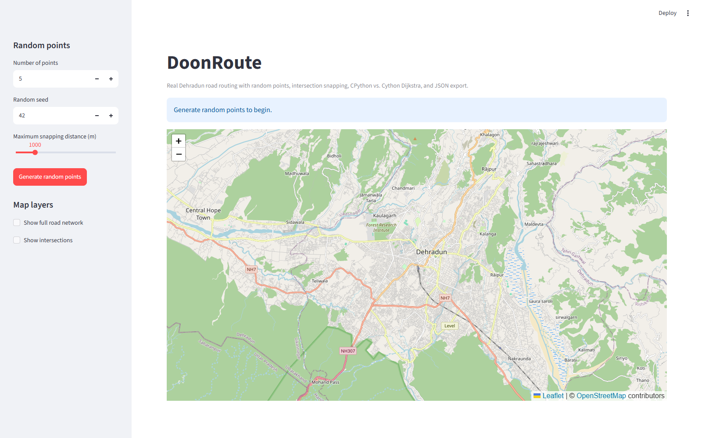
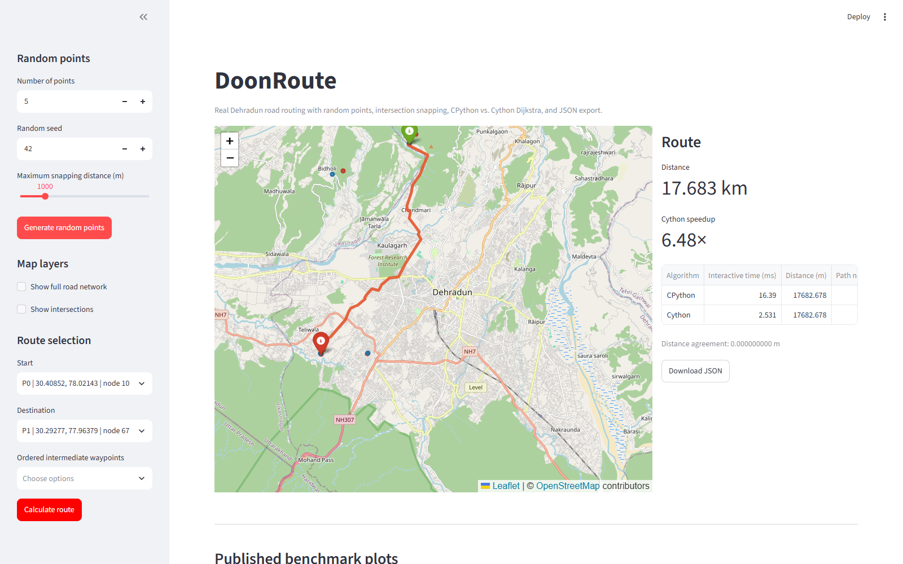

# DoonRoute

DoonRoute is a shortest-distance routing project over the real Dehradun road
network. Its central performance objective is strictly a Python-vs-Cython
performance comparison: Python is the baseline normal Python implementation, and
Cython is the independent optimized implementation. It snaps random or configured
points to road intersections, supports ordered waypoints, exports routes as
JSON, and provides a Streamlit/Folium frontend.

The primary benchmark uses exactly these two implementations. C++ and NetworkX
are excluded from the performance comparison.

There is no C++ implementation or C++ build path in this project. The Cython
extension is compiled as a native C extension.

## What is included

- Real Dehradun GraphML road network: **28,248 nodes** and **64,912 directed
  edges**.
- Intersection detection from road connectivity and OSM `junction` tags:
  **17,804 valid intersections**.
- Reproducible random points inside the graph bounds with KD-tree snapping to
  valid intersections and reported snap distances.
- Mandatory route A -> B -> C -> D and arbitrary start/destination/ordered
  waypoint routing.
- Pure Python Dijkstra and an independent Cython Dijkstra with CSR arrays, a C
  binary heap, typed arrays, and a `nogil` search core.
- Adaptive benchmark harness with warmups, repeated runs, median timing, visited
  counts, relaxations, and Python/Cython distance agreement.
- Reusable JSON route export with points, legs, combined path, and benchmark
  metadata.
- Streamlit + Folium frontend with random points, snapping, waypoint ordering,
  route comparison, JSON download, and published benchmark plots.

## Project layout

```text
doonroute/
  data/
    raw/dehradun_drive.graphml    Real road network
    raw/*.osm, *.osm.pbf          Source extracts
    locations.csv                 Preserved A-E locations
    processed/graph.bin            Generated binary graph
    exports/route_export.json      Generated sample export
  docs/
    algorithm.md                   Algorithm and data model
    architecture.md                Module and data-flow design
    results.md                     Verified distances and benchmarks
    location-research.md           Location evidence and source research
  frontend/
    app.py                         Streamlit/Folium application
  results/
    benchmark_results.csv          Latest benchmark rows
    route_results.csv              Latest route analysis rows
    *.png                          Generated plots
  scripts/
    build_cython.py                Build the Cython extension
    build_network.py               Optional source-data rebuild
    run_analysis.py                Route verification and JSON export
    run_benchmarks.py              Benchmark and plot generation
  src/
    graph_loader.py
    intersection.py
    random_points.py
    routing.py
    python_dijkstra.py
    cython_dijkstra.pyx
    benchmark.py
    json_export.py
  tests/
    test_*.py
```

## Requirements

- Python 3.11+
- A C compiler for the Cython extension:
  - Windows: Microsoft Build Tools 2022 with MSVC
  - Linux/macOS: a working C toolchain

Runtime and test dependencies are pinned in `requirements.txt` and
`pyproject.toml`. Rebuilding the source GraphML from the OSM extract also needs
the optional `data` extras (`osmnx`, `osmium`).

## Setup

PowerShell:

```powershell
python -m venv .venv
.\.venv\Scripts\Activate.ps1
python -m pip install --upgrade pip
python -m pip install -r requirements.txt
python scripts/build_cython.py
```

The build produces `src/cython_dijkstra.cp311-win_amd64.pyd` on 64-bit Windows
Python 3.11. `tests/conftest.py` rebuilds it automatically if it is missing or
older than the `.pyx` source.

## Run

```powershell
$env:PYTHONPATH = "src"

# Verified distances and sample JSON
python scripts/run_analysis.py

# Python vs. Cython benchmarks and plots
python scripts/run_benchmarks.py

# Tests and lint
python -m pytest
python -m ruff check .
python -m ruff format --check .

# Frontend
python -m streamlit run frontend/app.py
```

The frontend opens at `http://localhost:8501` by default.

## Algorithms

### Python Dijkstra

`src/python_dijkstra.py` uses a heap-based Dijkstra search with lazy deletion.
It accepts a dict-of-lists adjacency mapping and returns a `PathResult` with
distance, path, visited count, relaxation count, and source/target metadata.
Negative weights are rejected.

### Cython Dijkstra

`src/cython_dijkstra.pyx` is an independent implementation, not a wrapper around
the Python version. It reads the binary graph format into C arrays:

- `offsets` for CSR row boundaries
- `targets` for destination node indices
- `weights` for edge distances in metres

The search uses a typed C binary min-heap, deterministic node-ID tie-breaking,
typed arrays, and a `nogil` core loop. The result is reconstructed in Python
after the native search completes.

### Intersection snapping

`src/intersection.py` treats a node as a valid intersection when its undirected
road degree is at least three or the OSM node carries a non-false `junction` tag.
Valid intersections are projected into a local metre plane and indexed with a
SciPy `cKDTree`; queries return the nearest intersection and its projected-plane
snap distance. This differs from a haversine distance by under 0.25 m in the
audited 8-point sample.

`src/random_points.py` generates points using Python's seeded `random.Random`
inside the graph bounds and retries until each point snaps within the configured
maximum distance. If no valid intersection is available, it raises a clear
error instead of silently dropping the point.

### Route composition

`src/routing.py` runs each leg independently, combines the paths without
duplicating boundary nodes, validates that every edge exists, and computes the
combined distance from the edge weights. Locations A-E preserve their original
coordinates and snapped OSM nodes.

## Benchmark method

Real-network benchmarks use the same binary graph, source/target pairs, weights,
and path reconstruction for both implementations. Each case runs three warmups
and ten measured repetitions. The reported value is the median. Speedup is:

```text
speedup = Python median / Cython median
```

Pure algorithm timing excludes graph loading and snapping. The optional
end-to-end workflow benchmark includes route composition, JSON document
construction, and serialization, so its speedup is lower and must not be
compared directly with the algorithm-only result.

Latest verified results on the development machine:

| Case | Python median | Cython median | Speedup | Agreement |
|---|---:|---:|---:|---:|
| A -> B | 19.549850 ms | 1.602750 ms | 12.20x | 0 m |
| B -> C | 0.236750 ms | 0.049550 ms | 4.78x | 0 m |
| C -> D | 11.232100 ms | 1.055950 ms | 10.64x | 0 m |
| Overall mandatory route | 31.018700 ms | 2.708250 ms | 11.45x | 0 m |
| End-to-end workflow | 79.542100 ms | 38.838600 ms | 2.05x | 0 m |

The exact values are in `results/benchmark_results.csv`; plots are written to
`results/*.png`. These numbers are machine-specific and are not claims about
other hardware.

### Benchmark plots and visual analysis

The generated benchmark plots visualize algorithm execution times, overall route performance, speedup factors, synthetic graph scaling, and route detour comparisons:

| Execution Time by Leg | Overall Performance Comparison |
|:---:|:---:|
|  |  |

| Cython Speedup over Python | Synthetic Graph Scaling ($n=1,000$ to $25,000$) |
|:---:|:---:|
|  |  |

| Mandatory vs. Unconstrained Route Comparison |
|:---:|
|  |

## Verified route

The mandatory route is A -> B -> C -> D, where D and E refer to the same Centrio
complex and therefore add no separate road distance.

| Leg | Distance |
|---|---:|
| A -> B | 14,354.483339 m |
| B -> C | 761.562784 m |
| C -> D | 2,899.095655 m |
| Mandatory total | 18,015.141778 m |
| Unconstrained A -> D | 14,835.391088 m |
| Detour caused by B and C | 3,179.750690 m |

Python and Cython agree on every verified route to within `1e-6 m`.

## JSON export

`src/json_export.py` builds a JSON document containing:

- project and export timestamp
- dataset path, node count, edge count, and weight units
- algorithm and execution time
- source, destination, and ordered waypoints
- original coordinates and snap distances
- per-leg distance, path node IDs, and path coordinates
- combined path, distance, and ordered waypoint indices
- optional benchmark metadata

The sample is `data/exports/route_export.json`. The frontend can download the
same structure for the currently calculated route.

## Tests

```powershell
python -m pytest
```

The suite covers:

- Python Dijkstra correctness, negative weights, disconnected graphs, and
  direct paths
- Cython/Python path and distance agreement
- intersection detection and snapping
- reproducible random points and snapping failures
- JSON round-trip and required fields
- waypoint composition, duplicate boundary removal, road names, and distance
  validation
- real Dehradun graph integration and mandatory route values

## Frontend screenshots

Initial map with the road-network layer:



Calculated route with snapping, waypoint markers, timings, and JSON download:



Both screenshots were captured from the running Streamlit application with
headless Chrome at 1600 x 1000.

## Limitations

- Distances are OSM road lengths; there is no live traffic, turn restriction
  modelling, or time-dependent cost.
- Random points snap to valid intersections, not to arbitrary road segments.
- The benchmark compares this project's Python and Cython implementations only.
- The end-to-end workflow includes Python-side JSON and route assembly overhead.
- Frontend timings are single interactive runs; use the benchmark script for
  medians.
- Plot images are generated from the latest local benchmark run.
