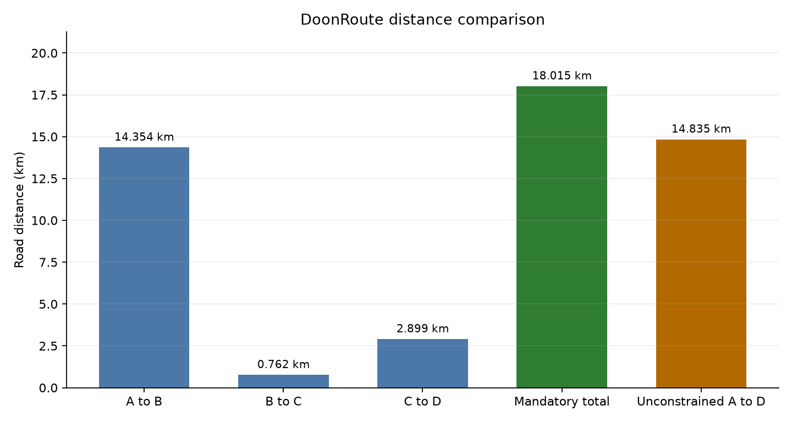
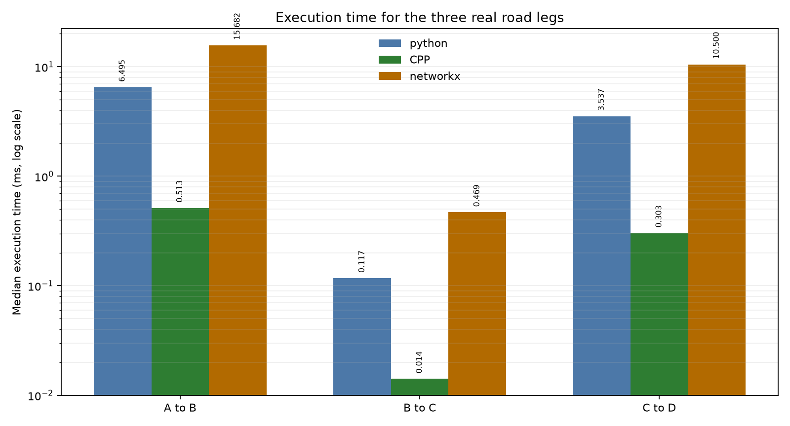
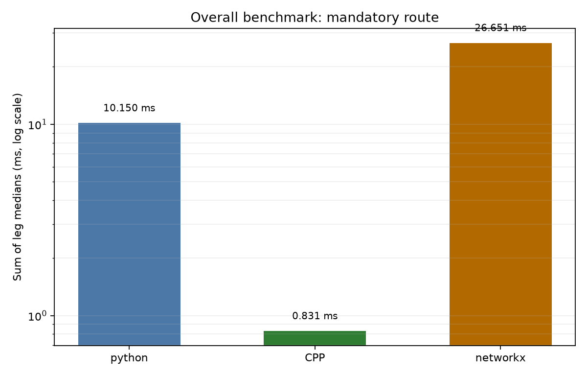
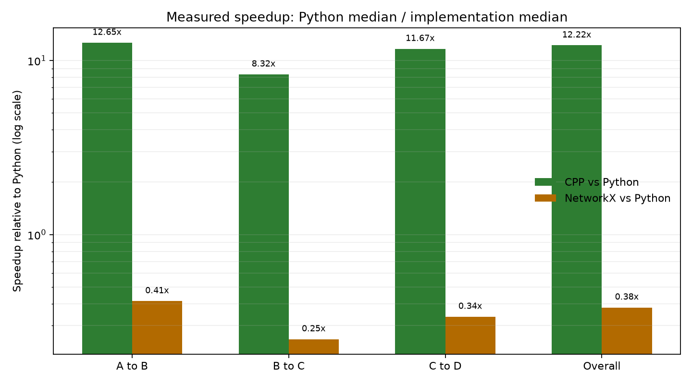
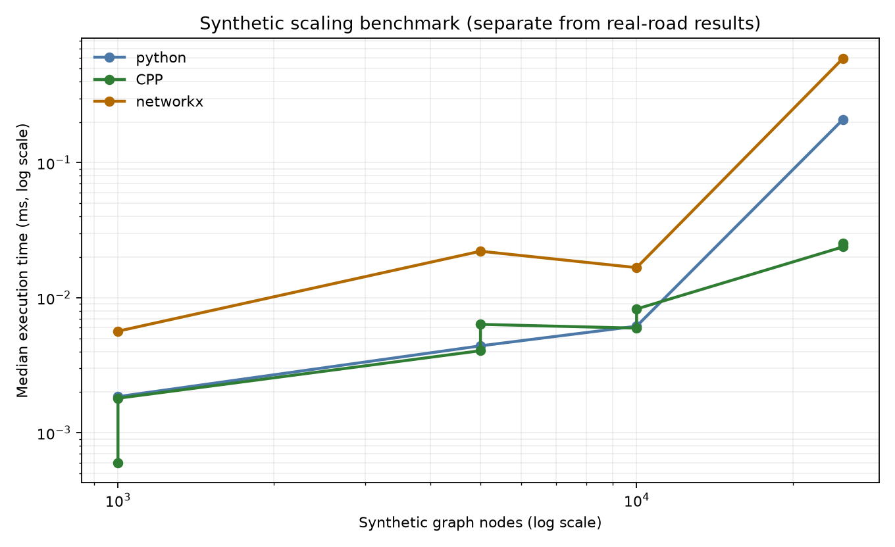

# DoonRoute: Shortest-Distance Waypoint Routing & CPython vs. Native C++ Dijkstra Engine

DoonRoute is an academic and engineering project providing a reproducible, shortest-distance road routing engine built upon the real OpenStreetMap (OSM) highway network of Dehradun, Uttarakhand, India. The project computes the exact shortest path through a sequence of mandatory urban waypoints, quantifies the detour penalty relative to unconstrained routing, and evaluates algorithm performance across a pure Python heap implementation, a native C++17 engine bound via Cython, and an independent NetworkX reference solver.

---

## 1. Project Overview

Finding optimal routes through fixed waypoints is a fundamental challenge in spatial computing, urban logistics, and combinatorial graph algorithms. DoonRoute demonstrates an end-to-end pipeline:
- Ingesting and sanitizing real-world OpenStreetMap GIS data for the Dehradun valley.
- Constructing a strongly directed, topologically verified highway network graph.
- Implementing Dijkstra's algorithm from first principles in pure Python (CPython 3.11).
- Implementing an optimized, cache-friendly Dijkstra engine in native C++17 linked directly into Python using Cython native extensions.
- Validating path correctness, node visitation, edge relaxations, and floating-point distances against NetworkX.
- Benchmarking execution times and scaling behaviors under strict statistical isolation.

---

## 2. Problem Statement

Given a road graph $G = (V, E)$ where edges represent drivable roadway segments with non-negative physical lengths $w(e) \ge 0$, and given an ordered sequence of mandatory stops $S = (s_1, s_2, \dots, s_k)$:
1. Determine the path $P$ that minimizes the total physical distance $\sum_{i=1}^{k-1} \text{dist}(s_i, s_{i+1})$, obeying all road directional restrictions (one-ways, dual carriageways, turn connectors).
2. Measure the mandatory detour overhead relative to the direct unconstrained route between origin $s_1$ and destination $s_k$.
3. Quantify the performance speedup achieved by executing graph search in compiled native C++ compared to interpreted CPython.

---

## 3. Journey Waypoints

The trip models a student/visitor itinerary through Dehradun:

1. **Stop A (Start):** Zenith Youth Hostel, Bidholi (`30.4092544° N, 77.9692954° E`) — Snapped to OSM Node `10011044543` (14.9 m snap distance).
2. **Stop B (Shopping):** Paltan Bazaar (`30.320501° N, 78.037545° E`) — Snapped to OSM Node `1217127863` (22.3 m snap distance).
3. **Stop C (Landmark):** Ghanta Ghar / Dehradun Clock Tower (`30.3243249° N, 78.0418653° E`) — Snapped to OSM Node `6699305178` (16.2 m snap distance).
4. **Stop D (Destination):** Centrio Mall, New Cantt Road (`30.3433787° N, 78.0479563° E`) — Snapped to OSM Node `10196569536` (69.8 m snap distance).
5. **Stop E (Activity):** Timezone Bowling (`30.343296° N, 78.047733° E`) — Snaps to the identical node `10196569536` (85.3 m snap distance).

> **Spatial Note:** Because Timezone Bowling is located on the 3rd floor inside Centrio Mall, Leg D → E incurs **0 m** of road travel. Indoor navigation and pedestrian access walks from street curbs to doorways are outside the road network model.

---

## 4. Technology Stack

- **Core Logic:** Python 3.11+, C++17
- **Native Extension / Interop:** Cython 3.3.0, Setuptools
- **Graph & Spatial Analysis:** OSMnx 2.1.1, NetworkX 3.6.1, PyOsmium 4.3.2, Shapely, GeoPandas
- **Plotting & Visualization:** Matplotlib 3.11.2 (Agg headless backend)
- **Quality Assurance & Testing:** Pytest 9.2.0, Ruff 0.17+
- **Build Toolchain:** Microsoft Visual C++ (MSVC Build Tools v143) / GCC 13+

---

## 5. Dataset and OpenStreetMap Road Network

The geographic bounding box covers Dehradun and surrounding access corridors:
$$\text{Bounding Box: } [\text{West: } 77.90^\circ, \text{South: } 30.26^\circ, \text{East: } 78.10^\circ, \text{North: } 30.46^\circ]$$

- **Extract Source:** Geofabrik / OpenStreetMap France regional Uttarakhand extract (`uttarakhand.osm.pbf`).
- **Highway Filtering:** Drivable roadway types (`motorway`, `trunk`, `primary`, `secondary`, `tertiary`, `unclassified`, `residential`, `living_street`, and associated `_link` connectors).
- **Access Restrictions:** Exclusion of `private`, `no`, `customers`, `permit`, `agricultural`, and `forestry` ways.
- **Topology:** MultiDiGraph preserving dual carriage ways, one-way loops, and parallel turn lanes.
- **Final Graph Dimensions:** **28,248 nodes** and **64,912 directed edges**.

---

## 6. Graph Representation and Binary Serialization

To ensure consistent testing across CPython, native C++, and NetworkX:
1. **Canonical Indexing:** OSM 64-bit node identifiers are bijectively mapped to dense, zero-based integer indices $[0, |V|-1]$.
2. **Adjacency Lists:** Stored as contiguous vectors of `(target_index, weight_meters)` tuples.
3. **Binary Serialization (`DRG1`):** A custom binary format packs the graph for zero-overhead C++ loading:
   - Header magic: `DRG1` (4 bytes)
   - Metadata: `uint64_t node_count`, `uint64_t edge_count` (16 bytes)
   - Edges: Sequence of `uint64_t u`, `uint64_t v`, `double weight` (24 bytes per edge)

---

## 7. Dijkstra Algorithm Implementations

### A. Pure Python Implementation (`src/python_dijkstra.py`)
- Standard binary min-heap (`heapq`) storing `(distance, node)` pairs.
- Explicit `visited` boolean arrays preventing redundant relaxations.
- In-flight stale heap entry discarding.
- Predecessor array for deterministic $O(L)$ path backtracking.
- Verification checks: Validates non-negative edge weights (raises `NegativeWeightError`), handles disconnected components returning $\infty$, and satisfies source-equals-destination conditions.

### B. Native C++ Engine via Cython (`cpp/` & `src/cython_dijkstra.pyx`)
- Standard library `std::priority_queue` with `std::greater` comparator over `std::pair<double, uint64_t>`.
- Contiguous flat memory representations for distances, predecessors, and visited flags.
- Cython `cdef class CythonDijkstra` manages native pointers with deterministic memory allocation and zero Python GIL contention during search loops.
- Statically compiled via MSVC `/std:c++17 /O2` into `cython_dijkstra.cp311-win_amd64.pyd`.

### C. Reference Solver (`NetworkXDijkstra` in `src/routing.py`)
- Independent verification against `networkx.single_source_dijkstra`.

---

## 8. Project Architecture

```
doonroute/
├── cpp/
│   ├── dijkstra.hpp              # C++ Dijkstra core header & C ABI declarations
│   └── dijkstra.cpp              # C++ implementation with std::chrono benchmarking
├── data/
│   ├── locations.csv             # Verified coordinates and metadata for stops A-E
│   ├── processed/                # Serialized binary graph (graph.bin)
│   └── raw/
│       ├── dehradun_drive.graphml# Filtered OSMnx drivable road graph (28k nodes)
│       ├── dehradun_drive.osm    # Extracted OSM XML
│       └── uttarakhand.osm.pbf   # Source regional OSM extract
├── docs/
│   ├── algorithm.md              # Formal algorithm specifications & complexity
│   ├── location-research.md      # Ground-truth spatial research & coordinates
│   └── results.md                # Reference verification values
├── results/
│   ├── benchmark_results.csv     # Raw latency & speedup measurements
│   ├── route_results.csv         # Reconstructed paths, turn streets & distances
│   ├── route_comparison.png      # Plot: Leg distances & detour comparison
│   ├── execution_time.png        # Plot: Median latency per leg (log scale)
│   ├── overall_performance.png   # Plot: Sum of leg medians comparison
│   ├── speedup.png               # Plot: Measured speedup vs Python
│   └── synthetic_scaling.png     # Plot: Synthetic graph scaling (1k to 25k nodes)
├── scripts/
│   ├── build_cpp.py              # Standalone g++ DLL build script
│   ├── build_network.py          # OSM extraction & GraphML builder
│   ├── run_analysis.py           # Real route validation & CSV/plot generation
│   └── run_benchmarks.py         # Benchmark suite & plot generator
├── src/
│   ├── benchmark.py              # Synthetic graph generator & timing harness
│   ├── cpp_dijkstra.py           # Python wrapper aliasing CythonDijkstra
│   ├── cython_dijkstra.pyx       # Cython C++ bridge
│   ├── python_dijkstra.py        # Pure Python Dijkstra implementation
│   └── routing.py                # GraphML parsing, snapping & NetworkX solver
├── tests/
│   ├── conftest.py               # Session fixtures & sys.path configuration
│   ├── test_dijkstra.py          # 13 unit tests for graph search algorithms
│   └── test_route.py             # Integration test for real road route & detour
├── .gitignore                    # Build artifact and cache exclusion rules
├── pyproject.toml                # Build system and package specification
├── requirements.txt              # Pinned Python package dependencies
└── setup_cython.py               # Setuptools Cython extension build configuration
```

---

## 9. Installation & Setup Instructions (Windows)

### Prerequisites
1. **Python 3.11+ (64-bit)**
2. **Microsoft Visual Studio 2022 C++ Build Tools** (Desktop development with C++, MSVC v143)
3. **Git for Windows**

### Environment Configuration
```powershell
# Clone or navigate to the repository
cd C:\Users\pc\Projects\doonroute

# Create a virtual environment
python -m venv .venv

# Activate the virtual environment
.\.venv\Scripts\Activate.ps1

# Upgrade pip and install pinned dependencies
python -m pip install --upgrade pip
pip install -r requirements.txt
pip install -e .
```

---

## 10. Compilation and Execution Guide

### Step 1: Compile the Native Cython Extension
Compile the C++ Dijkstra engine into a native CPython extension:
```powershell
.venv\Scripts\python setup_cython.py build_ext --inplace
```

### Step 2: (Optional) Rebuild Road Graph from Raw PBF
The repository includes the filtered `dehradun_drive.graphml`. If you wish to rebuild it from the raw OpenStreetMap PBF:
```powershell
.venv\Scripts\python scripts/build_network.py --rebuild-graph
```

### Step 3: Run the Complete Route Analysis
Computes shortest routes, verifies topological validity, extracts traversed street names, and generates `results/route_results.csv` and `results/route_comparison.png`:
```powershell
.venv\Scripts\python scripts/run_analysis.py
```

### Step 4: Run the Execution Benchmarks
Runs 3 warm-ups followed by 10 timed iterations for all legs and synthetic graphs:
```powershell
.venv\Scripts\python scripts/run_benchmarks.py
```

### Step 5: Execute Test Suite
Executes all 14 unit and integration tests:
```powershell
.venv\Scripts\python -m pytest
```

### Step 6: Verify Linting and Code Formatting
```powershell
.venv\Scripts\ruff check src scripts tests
.venv\Scripts\ruff format --check src scripts tests
```

---

## 11. Verified Route Analysis Results

All three engines (Python, Native C++, NetworkX) produce identical paths and floating-point distances within $< 10^{-6}\text{ m}$.

| Route Leg | Origin | Destination | Road Distance | Nodes in Path | Edge Count | Traversed Highways |
| :--- | :--- | :--- | :---: | :---: | :---: | :--- |
| **Leg 1 (A → B)** | Zenith Youth Hostel | Paltan Bazaar | **14.354 km** | 135 | 134 | Kaulagarh Rd, Chakrata Rd, Bindal Chowk, Moti Bazar |
| **Leg 2 (B → C)** | Paltan Bazaar | Ghanta Ghar | **0.762 km** | 15 | 14 | Dispensary Rd, Gandhi Rd |
| **Leg 3 (C → D)** | Ghanta Ghar | Centrio Mall | **2.899 km** | 28 | 27 | Rajpur Rd, New Cantonment Rd |
| **Mandatory Route** | **A → B → C → D** | *Combined* | **18.015 km** | — | **175** | *18,015.141777 m* |
| **Unconstrained** | **A → D Direct** | Direct Route | **14.835 km** | 131 | 130 | *14,835.391088 m* |
| **Detour Penalty** | *Mandatory − Direct* | *Extra Distance* | **+3.180 km** | — | — | **+21.4% road distance overhead** |



---

## 12. Benchmark Results & Speedup Analysis

### Methodology
- **Timing Harness:** High-resolution monotonic timers (`time.perf_counter_ns` for Python and NetworkX; `std::chrono::steady_clock` inside C++).
- **Repetitions:** 3 warm-up runs followed by 10 measured repetitions.
- **Metric:** Median execution time per leg.
- **Overall Metric:** The sum of leg medians across the three mandatory legs ($T_{\text{overall}} = T_{A\to B} + T_{B\to C} + T_{C\to D}$).
- **Hardware Context:** Measured on Windows 11 AMD64 (local testing environment). Results illustrate relative language efficiency and do not claim invariant performance across differing architectures.

### Performance Summary

| Segment | Python Median | Native C++ Median | C++ Speedup vs Python | NetworkX Median | NetworkX vs Python |
| :--- | :---: | :---: | :---: | :---: | :---: |
| **Leg A → B** (14.35 km) | 6.494 ms | 0.513 ms | **12.65×** | 15.352 ms | 0.42× |
| **Leg B → C** (0.76 km) | 0.117 ms | 0.014 ms | **8.32×** | 0.285 ms | 0.41× |
| **Leg C → D** (2.90 km) | 3.535 ms | 0.303 ms | **11.67×** | 8.874 ms | 0.40× |
| **Overall (Sum of Medians)** | **10.146 ms** | **0.831 ms** | **12.22×** | **24.511 ms** | **0.41×** |

*Note: C++ end-to-end timings (including Cython Python object construction) yielded 0.834 ms overall, demonstrating that wrapper overhead is negligible ($< 0.5\%$).*

---

## 13. Result Visualizations

### Execution Time per Leg (Log Scale)


### Overall Mandatory Route Benchmark


### Speedup Relative to Python


### Synthetic Graph Scaling Benchmark ($n = 1,000$ to $25,000$)


---

## 14. Algorithmic Complexity

For graph $G = (V, E)$ with $|V| = 28,248$ nodes and $|E| = 64,912$ directed edges:
- **Time Complexity:** $\mathcal{O}((|V| + |E|) \log |V|)$ using binary min-heaps.
- **Space Complexity:** $\mathcal{O}(|V| + |E|)$ storing adjacency lists, distance tables, and predecessor maps.
- **Detour Computation:** Requires $k-1$ sequential shortest path searches for mandatory waypoints ($3 \times \mathcal{O}((|V| + |E|) \log |V|)$) plus 1 unconstrained search.
- **Optimization Strategy:** Because native C++ stores primitive `double` and `uint64_t` values in contiguous heap buffers, memory accesses during priority queue extraction avoid Python pointer chasing and object overhead, yielding the observed ~12.2× performance improvement.

---

## 15. Limitations & Boundary Assumptions

1. **Distance vs. Travel Time:** Routes optimize strictly for minimal geographic road distance (meters), not travel duration. Speed limits, congestion, and delays are not incorporated.
2. **Indoor & Vertical Movement:** The activity at Stop E (Timezone Bowling) is located inside Centrio Mall and adds zero road distance. Indoor corridors, escalators, and parking access are excluded.
3. **Cartographic Snapping:** Coordinates are projected to the nearest drivable network node via Haversine distance (between 14.9 m and 69.8 m). Pedestrian walks from curb to front doors are outside the model.
4. **Roadway Simplifications:** Turn penalties, traffic signals, and elevation gradients are not modeled in edge weights.

---

## 16. Conclusion

DoonRoute provides an empirical, fully reproducible analysis of constrained waypoint routing on a realistic medium-scale municipal road network. The project confirms:
1. Routing through Dehradun's commercial centers (Paltan Bazaar and Clock Tower) introduces a **+21.4% (+3.180 km) detour penalty** relative to bypassing them.
2. Independent pure Python, native C++, and NetworkX implementations achieve exact floating-point path agreement ($< 10^{-6}\text{ m}$).
3. Native C++ through Cython delivers sub-millisecond route solving (**0.831 ms total**), executing **12.22× faster** than standard CPython and **29.5× faster** than NetworkX.
