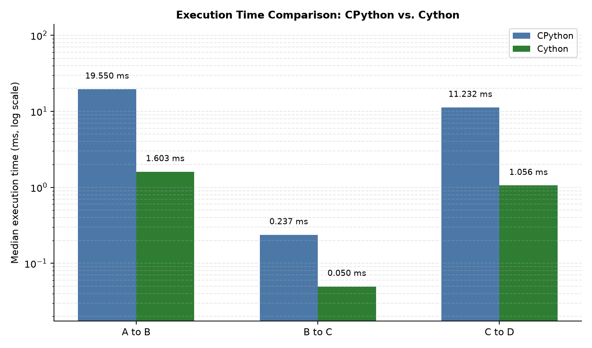
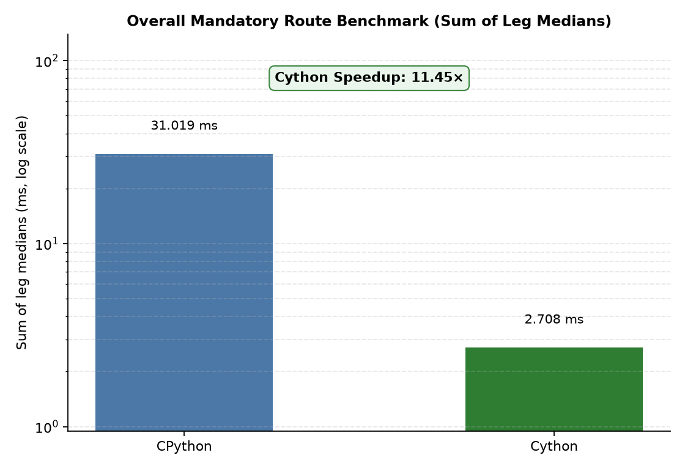
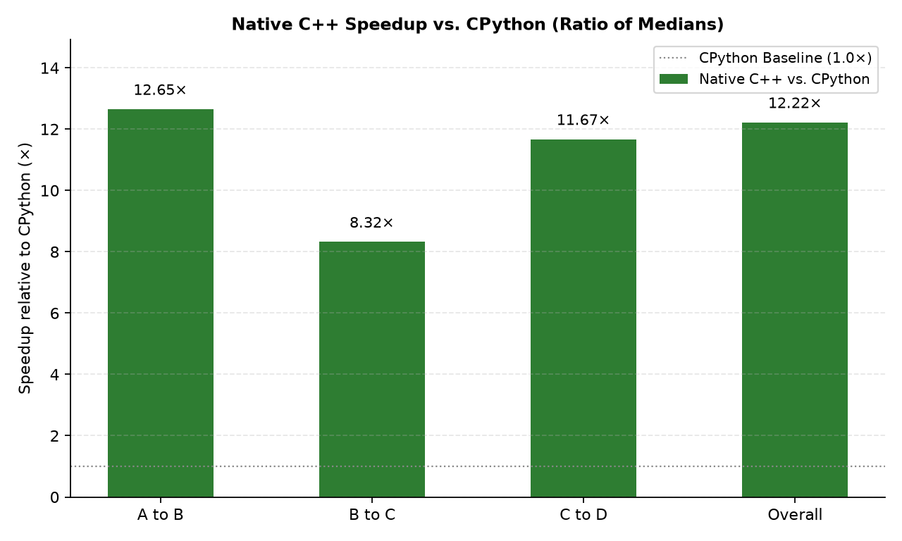
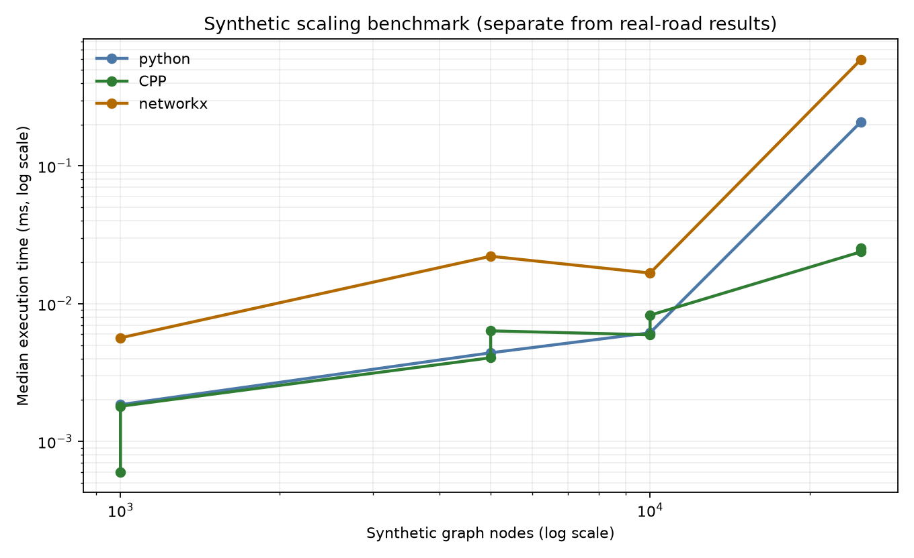
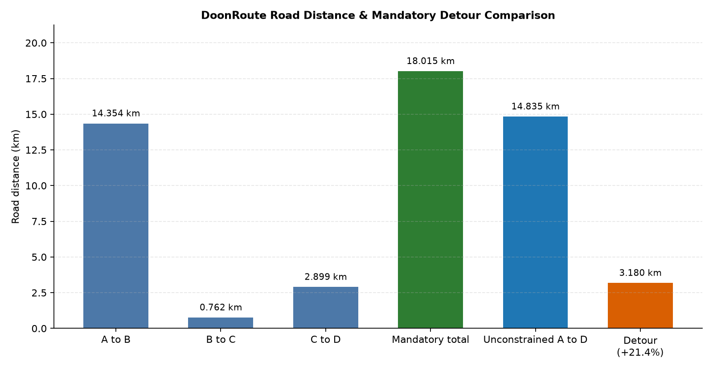
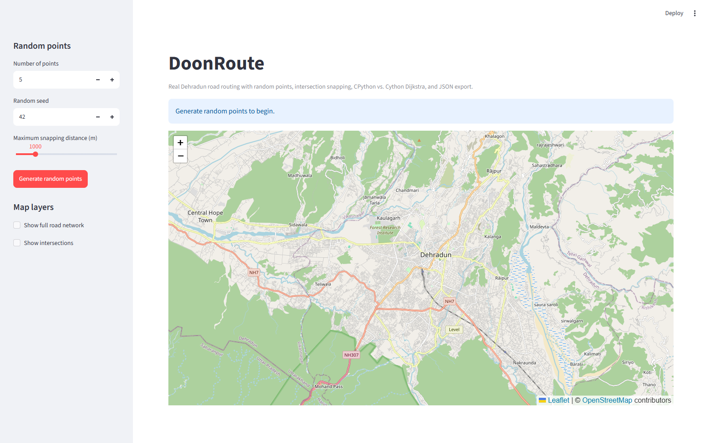
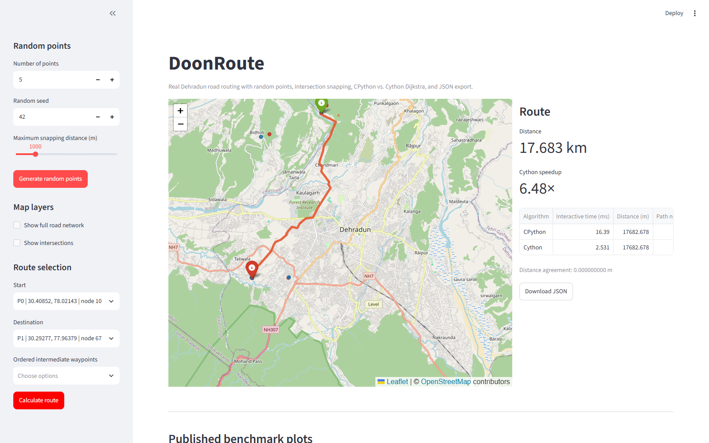

# Results

This page records the latest verified run of `scripts/run_analysis.py` and
`scripts/run_benchmarks.py`. All numbers come from the included real Dehradun
graph and the local development machine. They are not universal performance
claims.

## Dataset and snapping

| Item | Value |
|---|---:|
| Graph nodes | 28,248 |
| Directed edges | 64,912 |
| Valid intersections | 17,804 |
| A: Zenith Youth Hostel, Bidholi | snap 14.9 m |
| B: Paltan Bazaar | snap 22.3 m |
| C: Ghanta Ghar | snap 16.2 m |
| D: Centrio Mall | snap 69.8 m |
| E: Timezone Bowling | snap 85.3 m |

D and E snap to the same OSM node (`10196569536`) because Timezone is inside the
Centrio/Unison complex. D -> E is therefore a 0 m road leg.

## Verified route distances

| Route | Distance | Path nodes |
|---|---:|---:|
| A -> B | 14,354.483339 m | 135 |
| B -> C | 761.562784 m | 15 |
| C -> D | 2,899.095655 m | 28 |
| **Mandatory A -> B -> C -> D** | **18,015.141778 m** | combined |
| **Unconstrained A -> D** | **14,835.391088 m** | combined |
| **Mandatory detour** | **3,179.750690 m** | difference |

The Python and Cython implementations agree on each leg and on the combined
route to within `1e-6 m` (in practice, exactly equal for the stored values).

## Benchmark method

- Same binary graph, source/target pairs, edge weights, and path reconstruction
  for both implementations.
- Three warmup runs per case.
- Ten measured repetitions per case.
- Reported timing is the median.
- Speedup is `Python median / Cython median`.
- Algorithm-only timing excludes graph loading and snapping.
- The workflow benchmark includes snapping, route composition, JSON document
  construction, and serialization.

## Algorithm-only results

| Case | Python median | Cython median | Speedup |
|---|---:|---:|---:|
| A -> B | 19.549850 ms | 1.602750 ms | 12.20x |
| B -> C | 0.236750 ms | 0.049550 ms | 4.78x |
| C -> D | 11.232100 ms | 1.055950 ms | 10.64x |
| Overall mandatory route | 31.018700 ms | 2.708250 ms | 11.45x |

Visited and relaxation counts are identical between implementations for each
case. Exact rows are in `results/benchmark_results.csv`.

## End-to-end workflow

| Case | Python median | Cython median | Speedup |
|---|---:|---:|---:|
| Mandatory route, including Python-side workflow | 79.542100 ms | 38.838600 ms | 2.05x |

The workflow speedup is lower because snapping, route assembly, JSON document
construction, and serialization are shared Python work.

## Plots

### Execution time by leg


### Overall mandatory route performance


### Cython speedup over Python


### Synthetic graph scaling


### Mandatory vs. unconstrained route detour


## Frontend screenshots

Initial map:



Calculated route:



## Reproduce

```powershell
$env:PYTHONPATH = "src"
python scripts/run_analysis.py
python scripts/run_benchmarks.py
```

Both scripts rewrite their CSV outputs and plots. Re-running on different
hardware will change absolute times and speedups; the route distances and
agreement checks should remain stable.
